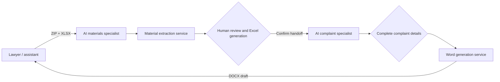

<div align="center">

# Feishu Legal AI Workgroup

[简体中文](README.md) · **[English](README.en.md)**

<picture>
  <source media="(max-width: 640px)" srcset="docs/assets/readme-hero-mobile.svg">
  
</picture>

**Connect case-material extraction, human review, and complaint drafting in a workflow shared by lawyers and two AI specialists.**

[Watch the video](#introduction-video) · [Workflow](#how-the-two-roles-work-together) · [Actual screens](#actual-application-screens) · [Try locally](#quick-start) · [Deployment and docs](#deployment-and-documentation)


[](LICENSE)

</div>

> [!IMPORTANT]
> Currently supports **financial loan contract disputes only** and is undergoing internal validation at a law firm. Material review, confirmation of complaint details, and final lawyer review must all remain in place. Generated documents are drafts requiring review. The application and demo media are in Chinese.

## Introduction video

**v4.1 · 2 minutes 49 seconds**: see group collaboration, material review, field handoff, and Word drafts returned to the group, followed by the three supporting services. This is the v4.1 promotional video with its original visuals, narration, and complete timeline.

https://github.com/user-attachments/assets/e7f099f3-2b2a-48c2-b5fd-418a3c57ab95

[Watch / download the original 1080p v4.1 video](docs/assets/feishu-legal-intro.mp4?raw=true)

<details>
<summary>Video contents and demonstration notes</summary>

- First half: the two AI roles, material review, supplementary confirmation, and drafts returned to the group.
- Second half: architecture, material extraction, fixed-template generation, and audit records.
- Group-chat scenes use local end-to-end execution records and bot-card data. Feishu network transmission is recorded by test doubles to illustrate the collaboration workflow.
- Screenshots below come from local runs of the current public code, using explicitly fictional test data.

</details>

## What problem does it solve?

For lawyers and assistants handling financial loan disputes, the project connects material organization, Excel review, supplementary complaint details, and Word document preparation. **AI organizes and drafts; people decide whether the case can proceed to the next step.**

### How the two roles work together

| AI role | Input | Responsibility | Output |
| --- | --- | --- | --- |
| **AI materials specialist** | Case ZIP + XLSX case table | Extract fields from PDF, Word, images, and file paths; flag missing or conflicting values; wait for human review | Confirmed case fields and Excel file |
| **AI complaint specialist** | Fields handed over by the materials specialist + complaint-specific details | Validate required fields, apply a fixed Word template, and produce a downloadable draft in the group | DOCX complaint draft |



The lawyer or assistant confirms twice: first by checking the materials and approving the handoff, then by completing and confirming complaint details. The generated draft still requires final review.

V1 supports **one group, one active case, and one financial loan template**. See [architecture](docs/architecture.md) (Chinese) for detailed state transitions.

## Actual application screens

### 01 / Material review: check the source before confirming a field


A DOCX was generated from the repository's fictional case and processed together with a test XLSX. Results retain field provenance, missing-value warnings, and manual editing controls. The displayed counts describe this sample only.

### 02 / Document generation: structured entry and a matching template preview


The repository's fictional sample text was pasted, parsed, and used to generate the preview and Word file. The web preview highlights filled values in yellow for review; the downloaded DOCX removes that highlighting.

## Implemented capabilities

| Capability | Current implementation |
| --- | --- |
| **Material organization** | PDF text layers, DOCX, image OCR, and material-path extraction; XLSX header mapping, preservation of unverified existing values, and missing/conflicting-value flags |
| **Document generation** | 83 structured fields, local pasted-text parsing, manual correction, a fixed DOCX template, and a matching web preview |
| **Group collaboration** | Feishu long connection, file downloads, review cards, supplementary-information pages, and DOCX delivery; retries after send timeouts and a manual resend entry point |
| **Operation and traceability** | SQLite case state, random access tokens, event deduplication, and operation auditing; Windows local execution and Linux private-deployment templates |

## Quick start

### Try the complaint-generation interface first

Requires **Python 3.10+**. This entry point uses only the Python standard library; no Feishu app or Microsoft Word installation is needed.

```bash
git clone https://github.com/ZhangShixing0/feishu-legal-ai-workgroup.git
cd feishu-legal-ai-workgroup
python server.py
```

Open `http://127.0.0.1:8765/` and click **载入演示数据 (Load demo data) → 生成预览 (Generate preview) → Word** to generate a document for a fictional case. Fields and templates must still be reviewed against the actual case.

<details>
<summary>Windows setup and command-line example</summary>

Run `setup.bat` in the repository directory to create the environment and install dependencies, then use `run.bat` to start the document-generation interface.

Generate a completely fictional sample document from the command line:

```powershell
python legal_generator.py examples/sample_case.json outputs/manual-test.docx
```

</details>

### Connect the full Feishu workgroup

Requires **two published, custom enterprise Feishu apps that have joined the same internal group**.

```bash
python -m venv .venv
# Windows: .venv\Scripts\activate
# Linux/macOS: source .venv/bin/activate
python -m pip install -r requirements.txt
```

1. Copy `.env.feishu.example` to `.env.feishu`. Fill in both apps' App ID and App Secret, the public HTTPS address, and the allowed group `chat_id`.
2. Activate the environment and run `python -m feishu_workgroup.run --check` to validate the configuration.
3. On Windows, run `run_feishu_v1.bat`. For continuous operation, follow the [deployment guide](docs/deployment.md) (Chinese).

Configure `MATERIAL_BANK_*` and `MATERIAL_LOAN_PRODUCT_*` locally only when institution- or product-specific recognition is needed. See the [Feishu workgroup guide](feishu_workgroup/README.md) (Chinese) for permissions, event subscriptions, and group operations.

### Verify the installation

```bash
python tools/run_checks.py
```

This runs the release audit, generator and Feishu orchestration tests, material extraction tests, and XLSX write-back tests. With Node.js installed, it also runs frontend text-parsing tests. CI uses `--require-node`.

## Deployment and documentation

The following guides are in Chinese.

| Continue here | Contents |
| --- | --- |
| [Architecture](docs/architecture.md) | Three services, data flow, and case state machine |
| [Feishu integration](feishu_workgroup/README.md) | App permissions, event subscriptions, configuration, and group operations |
| [Private deployment](docs/deployment.md) | Linux, systemd, Nginx, and continuous operation |
| [Material extractor](案件材料提取填表工具/README.md) | Run the ZIP → Excel tool independently |
| [Security](docs/security.md) | Data boundaries, threat model, and launch checklist |
| [Roadmap](docs/roadmap.md) | Current V1 scope and future queues, permissions, and templates |
| [Changelog](CHANGELOG.md) · [Contributing](CONTRIBUTING.md) | Version changes and development conventions |

<details>
<summary>Service entry points and project structure</summary>

| Service | Default address | Entry point |
| --- | --- | --- |
| Document-generation interface | `127.0.0.1:8765` | `server.py` |
| Case-material extractor | `127.0.0.1:8777` | `案件材料提取填表工具/server.py` |
| Feishu workgroup orchestration | `127.0.0.1:8788` | `python -m feishu_workgroup.run` |

The generator uses the Python standard library; the extractor uses bundled pypdf and Windows OCR / Linux Tesseract; Feishu orchestration depends on `requests`, `lark-oapi`, and two custom apps.

```text
feishu_workgroup/        Two AI specialists, state machine, Feishu client, and supplementary form
案件材料提取填表工具/     ZIP / PDF / DOCX / OCR extraction and XLSX write-back
templates/              Field models and anonymized Word templates
static/                 Document-generation frontend
tests/                  Generator, service, Feishu, and frontend tests
deploy/                 systemd / Nginx deployment templates
docs/                   Architecture, security, deployment, and roadmap
tools/                  Unified checks and release security audit
```

</details>

## Data and security boundaries

The local generation interface processes materials on the same machine. **The Feishu collaboration version sends original case files into an internal Feishu group.** Disable external membership, configure the group allowlist, and implement HTTPS, access controls, and a data-retention policy.

<details>
<summary>Publication and usage constraints</summary>

- `.env.feishu`, `tmp/`, `outputs/`, `work/`, and `feishu_workgroup/data/` are excluded from Git.
- Repository examples and product screenshots use dedicated fictional test data. Do not upload real case materials or credentials to issues, PRs, or commit history.
- Supplementary-information pages use random tokens and disable caching; their links should still not be shared outside the group.
- The local terminal window must remain running. The bots go offline when the computer shuts down; continuous use requires an always-on server.
- Before submitting code, read [Contributing](CONTRIBUTING.md) (Chinese) and run `python tools/run_checks.py`.

</details>

## License and disclaimer

The repository is publicly viewable, but **no open-source license is currently granted; all rights are reserved**. Other use requires separate written authorization; see [LICENSE](LICENSE). This is a technical workflow prototype, not legal advice, and it cannot replace a licensed lawyer's review of facts, evidence, claims, and final documents.
