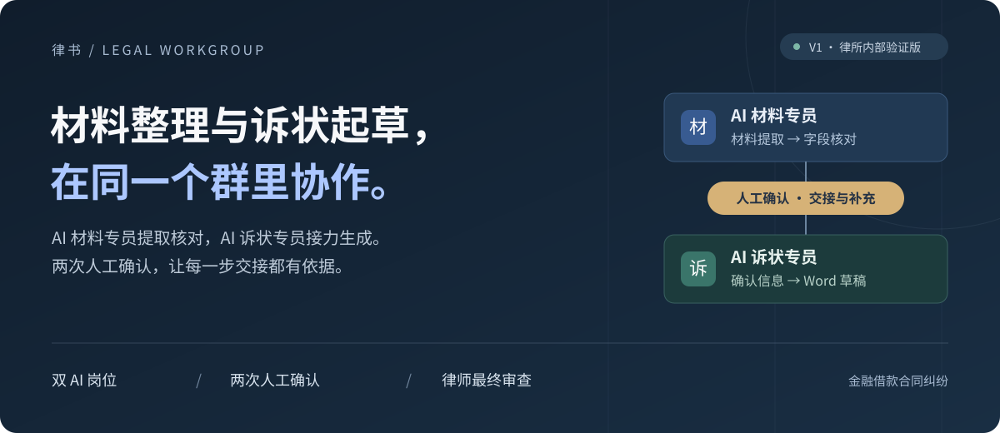
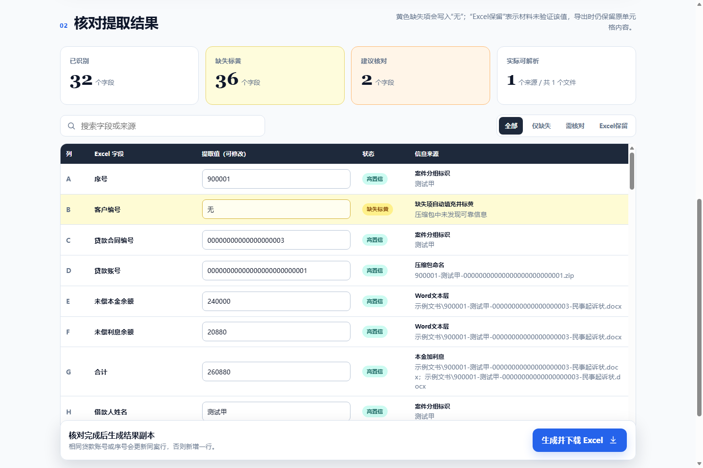
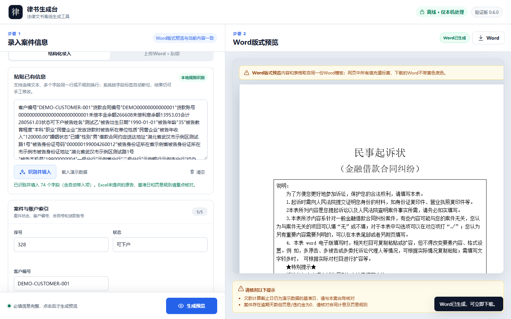

<div align="center">

# 飞书法律文书多智能体工作群

<picture>
  <source media="(max-width: 640px)" srcset="docs/assets/readme-hero-mobile.svg">
  
</picture>

**把案件材料提取、人工核对和起诉状生成，串成律师与两个 AI 员工的协作流程。**

[观看宣传片](#项目介绍视频) · [了解工作流](#两个岗位如何协作) · [查看真实界面](#实际运行界面) · [本地体验](#快速开始) · [部署与文档](#部署与文档)


[](LICENSE)

</div>

> [!IMPORTANT]
> 当前仅支持**金融借款合同纠纷**，处于律所内部验证阶段。材料核对、起诉信息确认和律师最终审查均须保留；生成结果是待复核的文书草稿。

## 项目介绍视频

**2 分 49 秒**，从同群协作看到材料核对、字段交接和 Word 草稿回传，再了解背后的三个服务。公开展示版已遮挡可读的证件号、账号、手机号和详细地址，保留原有配音与完整时间线。

https://github.com/user-attachments/assets/600a1d10-408b-424f-b171-a9fc58e54c2b

[观看 / 下载 1080p 完整视频（字段已遮挡）](docs/assets/feishu-legal-intro.mp4?raw=true)

<details>
<summary>视频内容与演示说明</summary>

- 前半段：两个 AI 岗位、材料核对、补充确认与草稿回群。
- 后半段：系统架构、材料提取、固定模板生成和审计记录。
- 群聊画面由本地端到端运行记录与机器人卡片数据呈现，飞书网络传输由测试替身记录；它用于说明协作流程。
- 下方截图来自当前公开代码的本地运行，均使用明确的虚构测试数据。

</details>

## 解决什么问题

面向处理金融借款案件的律师与助理，把分散的材料整理、Excel 核对、起诉信息补充和 Word 制作连在一起。**AI 整理与起草，人决定能否进入下一步。**

### 两个岗位如何协作

| 岗位 / 环节 | 做什么 | 交付什么 |
| --- | --- | --- |
| **AI 材料专员** | 读取案件 ZIP 与 XLSX，提取字段，标出缺失与冲突 | 等待人工核对的字段与来源 |
| **律师 / 助理** | 第一次核对材料并确认交接；第二次补充、确认起诉信息 | 经确认的案件数据 |
| **AI 诉状专员** | 接收已确认字段，校验必填项，填入固定模板 | 群内可下载的 DOCX 草稿 |

**上传材料 → 提取与核对 → 确认交接 → 补充起诉信息 → 生成草稿 → 律师最终审查**

当前 V1 为**单群、单活动案件、单一金融借款模板**。详细状态流转见 [架构说明](docs/architecture.md)。

## 实际运行界面

### 01 / 材料核对：看清来源，再确认字段



使用仓库虚构案例生成 DOCX，再连同测试 XLSX 实际运行提取。结果保留字段来源、缺失提示和人工修改入口；图中数量仅代表这个样例。

### 02 / 文书生成：结构化录入，同模板预览



粘贴仓库的虚构示例文本，识别后实际生成预览与 Word。网页标黄填充值便于核对，下载的 DOCX 自动移除黄色底色。

## 当前已实现

| 能力 | 当前实现 |
| --- | --- |
| **材料整理** | PDF 文本层、DOCX、图片 OCR 与材料路径提取；按 XLSX 表头映射，保留未验证既有值，标出缺失和冲突 |
| **文书生成** | 83 个结构化字段、本地文本粘贴识别、人工修正、固定 DOCX 模板与同模板网页预览 |
| **群内协作** | 飞书长连接、文件下载、审核卡片、补充页与 DOCX 回传；发送超时重试和人工重发入口 |
| **运行与追溯** | SQLite 案件状态、随机访问令牌、事件去重和操作审计；Windows 本地运行与 Linux 私有部署模板 |

## 快速开始

### 先体验诉状生成台

需要 **Python 3.10+**。这个入口只依赖 Python 标准库，无需飞书应用或 Microsoft Word。

```bash
git clone https://github.com/ZhangShixing0/feishu-legal-ai-workgroup.git
cd feishu-legal-ai-workgroup
python server.py
```

打开 `http://127.0.0.1:8765/`，点击 **载入演示数据 → 生成预览 → Word**，即可走完一次虚构案件的文书生成。字段与模板仍需按实际案件复核。

<details>
<summary>Windows 一键安装与命令行示例</summary>

在仓库目录运行 `setup.bat` 创建环境并安装依赖，随后用 `run.bat` 启动诉状生成台。

命令行生成完全虚构的示例文书：

```powershell
python legal_generator.py examples/sample_case.json outputs/manual-test.docx
```

</details>

### 再接入完整飞书工作群

需要**两个已发布、已加入同一内部群的飞书企业自建应用**。

```bash
python -m venv .venv
# Windows: .venv\Scripts\activate
# Linux/macOS: source .venv/bin/activate
python -m pip install -r requirements.txt
```

1. 将 `.env.feishu.example` 复制为 `.env.feishu`，填写两个应用的 App ID、App Secret、对外 HTTPS 地址与群白名单 `chat_id`。
2. 激活环境后运行 `python -m feishu_workgroup.run --check` 检查配置。
3. Windows 运行 `run_feishu_v1.bat`；持续在线部署按 [部署指南](docs/deployment.md) 配置。

需要识别特定机构或产品时，仅在本地配置 `MATERIAL_BANK_*`、`MATERIAL_LOAN_PRODUCT_*`。权限、事件订阅和群内操作见 [飞书工作群说明](feishu_workgroup/README.md)。

### 验证安装

```bash
python tools/run_checks.py
```

统一执行发布审计、生成器与飞书编排测试、材料提取与 XLSX 写回测试；安装 Node.js 后还会运行前端文本解析测试。CI 使用 `--require-node`。

## 部署与文档

| 从这里继续 | 内容 |
| --- | --- |
| [系统架构](docs/architecture.md) | 三个服务、数据流和案件状态机 |
| [飞书接入](feishu_workgroup/README.md) | 应用权限、事件订阅、配置和群内操作 |
| [私有部署](docs/deployment.md) | Linux、systemd、Nginx 与持续在线运行 |
| [材料提取器](案件材料提取填表工具/README.md) | 独立运行 ZIP → Excel 工具 |
| [安全说明](docs/security.md) | 数据边界、威胁模型和上线清单 |
| [项目路线图](docs/roadmap.md) | V1 当前范围与后续队列、权限、模板规划 |
| [更新记录](CHANGELOG.md) · [贡献指南](CONTRIBUTING.md) | 版本变化和开发约定 |

<details>
<summary>服务入口与项目目录</summary>

| 服务 | 默认地址 | 入口 |
| --- | --- | --- |
| 律书生成台 | `127.0.0.1:8765` | `server.py` |
| 案件材料提取器 | `127.0.0.1:8777` | `案件材料提取填表工具/server.py` |
| 飞书工作群编排 | `127.0.0.1:8788` | `python -m feishu_workgroup.run` |

生成台使用 Python 标准库；提取器使用内置 pypdf 与 Windows OCR / Linux Tesseract；飞书编排依赖 `requests`、`lark-oapi` 和两个自建应用。

```text
feishu_workgroup/        双 AI 员工、状态机、飞书客户端与补充页
案件材料提取填表工具/     ZIP / PDF / DOCX / OCR 提取与 XLSX 写回
templates/              字段模型与匿名化 Word 模板
static/                 律书生成台前端
tests/                  生成器、服务、飞书与前端测试
deploy/                 systemd / Nginx 部署模板
docs/                   架构、安全、部署和路线图
tools/                  统一检查与发布安全审计
```

</details>

## 数据与安全边界

本地生成台在本机处理材料；**飞书协作版会把原始案件文件带入飞书内部群**，需要关闭外部成员、配置群白名单，并落实 HTTPS、访问控制和数据留存策略。

<details>
<summary>发布与使用时的具体约束</summary>

- `.env.feishu`、`tmp/`、`outputs/`、`work/` 与 `feishu_workgroup/data/` 不进入 Git。
- 仓库示例和产品截图使用专用虚构测试数据；不要向 Issue、PR 或提交历史上传真实材料与凭证。
- 补充页使用随机令牌并禁止缓存，链接仍不应转发到群外。
- 本地黑色窗口必须保持运行；电脑关机后机器人也会离线。持续使用需部署到常开服务器。
- 提交代码前阅读 [贡献指南](CONTRIBUTING.md)，并运行 `python tools/run_checks.py`。

</details>

## 许可与免责声明

仓库公开供查看，**当前未授予开源许可，保留所有权利**；其他使用须另获书面授权，详见 [LICENSE](LICENSE)。本项目提供技术工作流原型，不构成法律意见，不能替代执业律师对事实、证据、诉讼请求与最终文书的审查。
