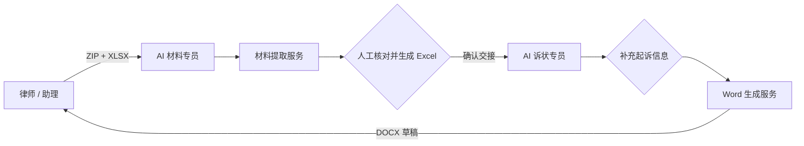

<div align="center">

# 飞书法律文书多智能体工作群

**把“案件材料提取与核对 → 起诉状补充与生成”拆成两个可审计的 AI 员工，放进同一个飞书群协作。**


</div>

> [!IMPORTANT]
> 当前版本是律所内部验证版，只支持金融借款合同纠纷场景。生成结果必须经过材料核对、起诉信息确认和律师最终审查，不应直接作为正式法律意见或未经复核的诉讼文件。


## 项目解决什么问题

传统批量诉讼流程里，材料整理、Excel 填表、起诉信息补充和 Word 制作往往分散在多个工具与人员之间。本项目把流程收束到一个飞书内部群，并明确划分为两个岗位：

| AI 员工 | 输入 | 责任 | 输出 |
| --- | --- | --- | --- |
| AI 材料专员 | 案件 ZIP + XLSX 案件表 | 提取 PDF、Word、图片和文件路径中的字段，提示缺失与冲突，等待人工核对 | 经确认的案件字段与 Excel |
| AI 诉状专员 | 材料专员交接字段 + 起诉专用补充信息 | 校验必填项，套用固定 Word 模板，生成群内可下载草稿 | DOCX 起诉状草稿 |



## 已实现能力

- 解析案件 ZIP 中的 PDF 文本层、DOCX、图片 OCR 结果和材料路径。
- 按 XLSX 表头映射字段；保留未验证的既有值，并单独标出缺失和冲突。
- 83 个起诉状字段的结构化录入、本地文本粘贴识别和人工修正。
- 基于固定 DOCX 模板生成 Word；网页预览标黄填充值，下载文件自动移除黄色底色。
- 飞书长连接收消息、文件下载、审核卡片、补充页和 DOCX 回传。
- SQLite 案件状态、随机访问令牌、事件去重和操作审计记录。
- 飞书发送超时重试、幂等键和审核卡片失败后的人工重发入口。
- Windows 本地体验与 Linux + systemd + Nginx 私有部署模板。

## 系统组成

| 服务 | 默认地址 | 主要入口 | 外部依赖 |
| --- | --- | --- | --- |
| 律书生成台 | `127.0.0.1:8765` | `server.py` | Python 标准库 |
| 案件材料提取器 | `127.0.0.1:8777` | `案件材料提取填表工具/server.py` | 内置 pypdf；Windows OCR 或 Linux Tesseract |
| 飞书工作群编排 | `127.0.0.1:8788` | `python -m feishu_workgroup.run` | `requests`、`lark-oapi`、两个飞书自建应用 |

更完整的组件边界、数据流和状态机见 [架构说明](docs/architecture.md)。

## 5 分钟本地复现

### 前提

- Windows 10/11；或 Python 3.10+ 的 Linux/macOS 环境。
- 仅体验诉状生成台时，不需要飞书应用，也不需要安装 Microsoft Word。
- 启用完整工作群时，需要两个已发布并加入同一内部群的飞书企业自建应用。

### Windows 一键安装

```powershell
git clone https://github.com/ZhangShixing0/feishu-legal-ai-workgroup.git
cd feishu-legal-ai-workgroup
setup.bat
```

只运行诉状生成台：

```text
run.bat
```

浏览器将打开 `http://127.0.0.1:8765/`。

### 通用命令安装

```bash
python -m venv .venv
# Windows: .venv\Scripts\activate
# Linux/macOS: source .venv/bin/activate
python -m pip install -r requirements.txt
python server.py
```

### 启动完整飞书工作群

1. 将 `.env.feishu.example` 复制为 `.env.feishu`。
2. 填写两个应用的 App ID、App Secret、对外 HTTPS 地址和允许使用的群 `chat_id`；生产环境如需识别特定机构或产品，再仅在本地填写 `MATERIAL_BANK_*`、`MATERIAL_LOAN_PRODUCT_*`。
3. 先检查配置，再启动：

```powershell
.venv\Scripts\python.exe -m feishu_workgroup.run --check
run_feishu_v1.bat
```

本地黑色窗口必须保持运行；电脑关机后机器人也会离线。要让群成员持续使用，请按 [部署指南](docs/deployment.md) 把三个服务部署到常开服务器。

飞书权限、事件订阅和群内操作步骤见 [飞书工作群说明](feishu_workgroup/README.md)。

## 验证安装

```powershell
.venv\Scripts\python.exe tools\run_checks.py
```

统一检查包括：

- 仓库发布安全审计；
- 诉状生成器、服务端和飞书编排单元测试；
- 材料提取与 XLSX 写回测试；
- 安装 Node.js 时额外运行前端文本解析测试。

命令行生成一个完全虚构的示例：

```powershell
.venv\Scripts\python.exe legal_generator.py examples\sample_case.json outputs\manual-test.docx
```

## 项目目录

```text
.
├─ feishu_workgroup/             # 双 AI 员工、状态机、飞书客户端与补充页
├─ 案件材料提取填表工具/          # ZIP/PDF/DOCX/OCR 提取与 XLSX 写回
├─ templates/                    # 字段模型与匿名化 Word 模板
├─ static/                       # 律书生成台前端
├─ tests/                        # 生成器、服务、飞书与前端测试
├─ deploy/                       # systemd / Nginx 配置模板
├─ docs/                         # 架构、安全、部署和路线图
├─ tools/                        # 统一检查与发布安全审计
├─ server.py                     # 律书生成服务
└─ legal_generator.py            # DOCX 生成核心
```

## 数据与安全边界

- `.env.feishu`、`tmp/`、`outputs/`、`work/` 和 `feishu_workgroup/data/` 不进入 Git。
- 仓库中的姓名、证件号、手机号、地址、账号和截图均为专用虚构测试数据。
- 飞书版会让原始案件文件进入飞书内部群，安全边界不同于纯本地模式；应关闭外部成员并配置群白名单。
- 补充页链接使用随机令牌并禁止缓存，但仍不应转发到群外。
- 生产环境必须使用 HTTPS、最小权限、访问控制、数据留存策略和律师人工复核。

完整威胁模型和上线清单见 [安全说明](docs/security.md)。

## 路线图

- **V1（当前）**：单群单活动案件、双 AI 员工、两次人工确认、单一金融借款模板。
- **V1.1**：多案件队列、任务超时恢复、运维状态页、结构化审计导出。
- **V1.2**：角色权限、留存策略、加密存储、模板版本和回归基线。
- **V2**：多类案由、多模板、批量任务和字段规则可配置化。
- **V3**：可评测的模型辅助抽取、证据出处定位、置信度门槛和人机协同学习。

里程碑、验收指标和明确不做的事项见 [项目路线图](docs/roadmap.md)。

## 参与开发

提交代码前请阅读 [贡献指南](CONTRIBUTING.md)，并运行 `python tools/run_checks.py`。严禁把真实案件材料、客户信息、飞书凭证或服务器密钥放入 Issue、Pull Request、测试夹具和提交历史。

## 许可与免责声明

当前仓库未授予开源许可，除非另有书面授权，保留所有权利。项目仅提供技术工作流原型，不构成法律意见，也不能替代执业律师对事实、证据、诉讼请求和最终文书的审查。
