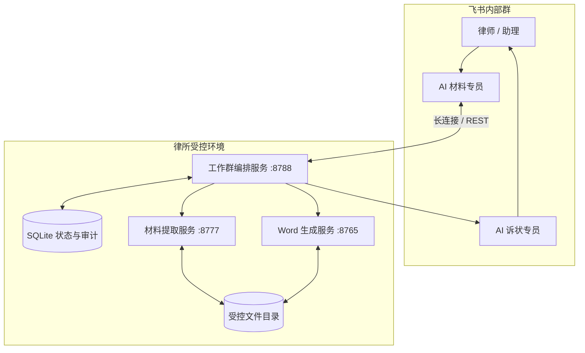
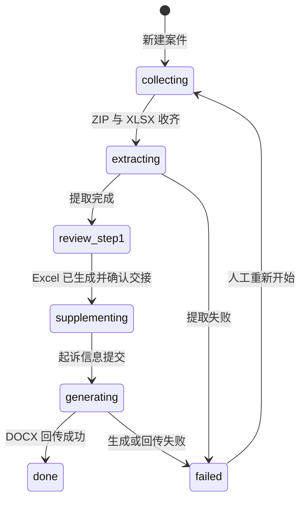

# 系统架构

## 设计目标

本项目把一个高风险、多人参与的法律文书流程拆成三个边界清晰的本地服务。自动化负责提取、映射、生成和状态流转；关键事实确认和最终法律判断仍由人完成。

设计原则：

1. 每一步都有明确输入、输出和责任人。
2. 原始材料、核对结果和起诉补充信息不在群消息里反复复制。
3. 网络超时不应抹掉已完成的提取结果。
4. Word 生成必须来自固定、可校验哈希的模板。
5. 飞书事件可重复到达，所有有副作用的处理都必须幂等。

## 组件视图

### 律书生成服务

- 入口：`server.py`、`legal_generator.py`。
- 监听：默认 `127.0.0.1:8765`。
- 责任：加载 83 字段模型、校验起诉状数据、修改 DOCX 的 `word/document.xml`、提供 HTML 预览和 DOCX 下载。
- 约束：模板哈希固定；生成副本只允许修改登记过的 Word 部件。

### 材料提取服务

- 入口：`案件材料提取填表工具/server.py`。
- 监听：默认 `127.0.0.1:8777`。
- 责任：安全解压、材料文本提取、OCR、字段规则分析、来源记录、冲突提示和 XLSX OOXML 写回。
- OCR：Windows 使用离线 OCR；Linux 使用 Tesseract `chi_sim+eng` 与 Poppler。
- 约束：多案件包无法根据 Excel 标识唯一定位时停止，不猜测目标案件。

### 飞书工作群编排服务

- 入口：`python -m feishu_workgroup.run`。
- 监听：默认 `127.0.0.1:8788`。
- 责任：接收消息、下载文件、调用两套本地服务、发送卡片、处理交互回调、回传 DOCX。
- 状态：SQLite 保存案件、文件路径、字段快照、随机令牌、事件去重键和审计事件。
- 网络可靠性：飞书 REST 发送使用超时重试和 UUID 幂等键；卡片发送失败不会把已完成的材料提取标成失败。

## 案件状态机

V1 在每个群中只维护一个活动案件，避免文件被错误归入另一个案件。后续版本将改为显式案件队列和案件选择器。

## 数据流

1. 飞书文件先进入内部群，再由材料专员下载到受控服务器目录。
2. 提取服务只接收本机 HTTP 请求，返回任务编号和字段分析结果。
3. 人工在核对页生成 Excel 后，编排服务才允许进入第二步。
4. 起诉补充页使用案件随机令牌；提交字段后调用生成服务。
5. 生成的 DOCX 上传到飞书并回传群聊；本地文件按留存策略清理。

## 端口与信任边界

| 端口 | 默认暴露范围 | 是否建议直接公网开放 |
| --- | --- | --- |
| 8765 | 回环地址 | 否 |
| 8777 | 回环地址 | 否 |
| 8788 | 回环地址，由 Nginx 代理补充页 | 否 |
| 443 | Nginx HTTPS | 是，但必须启用认证与访问控制 |

生产环境只开放 80/443；三个 Python 服务保持回环监听。反向代理负责 TLS、安全响应头、上传大小限制和访问认证。
